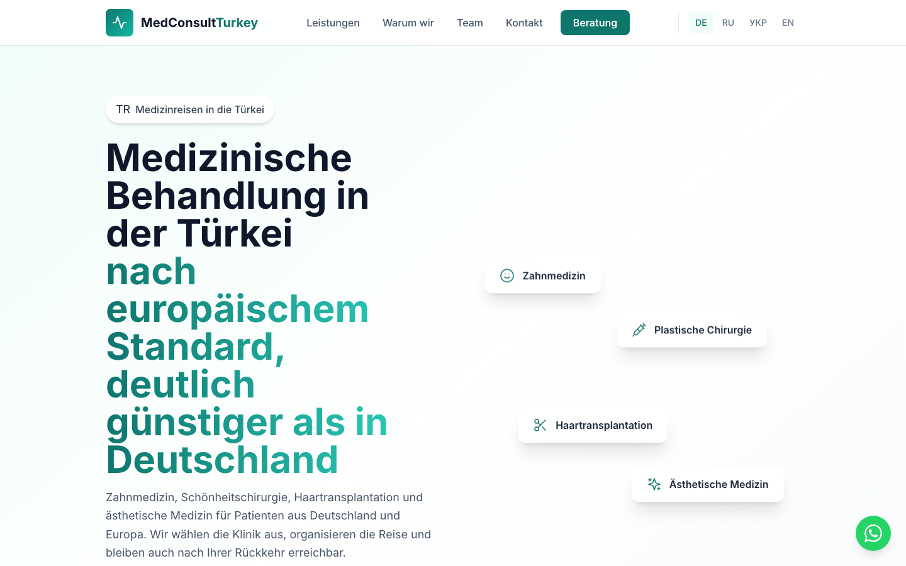
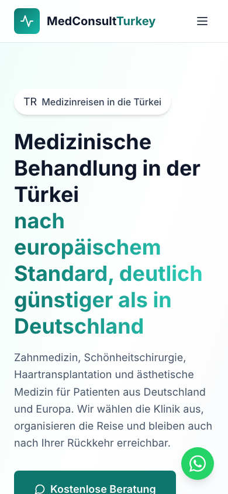
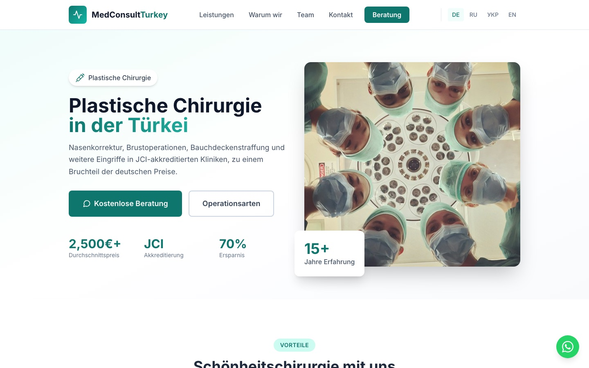
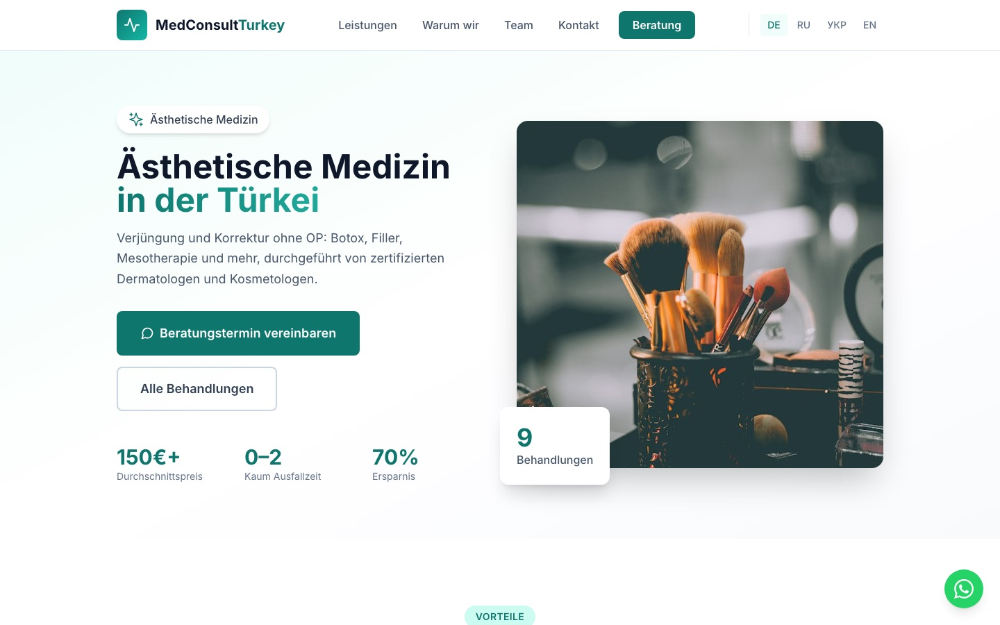
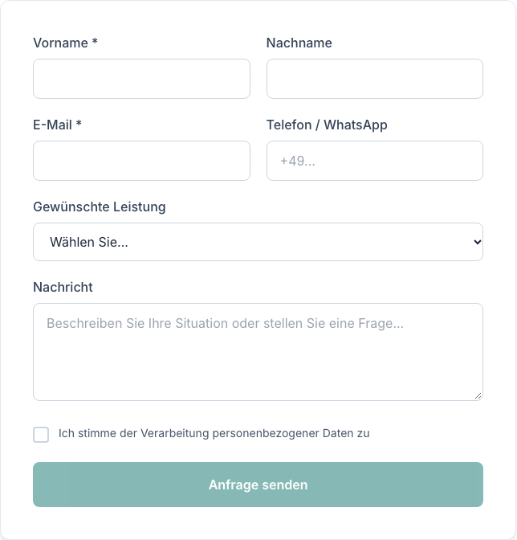
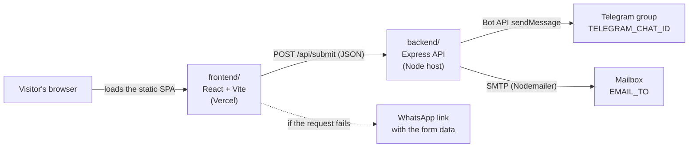

# MedConsult Turkey

[](https://github.com/IvanSytnik/medconsult-pro/actions/workflows/ci.yml)
[](LICENSE)


Multilingual website for a medical-tourism consultancy: dental care, plastic surgery, hair transplantation and aesthetic medicine in Turkey.

Live demo: https://medconsult.sytnik-studio.com (serves the Next.js rewrite from the `feat/next-app` branch, see [Status](#status)).

## Contents

- [About](#about)
- [Screenshots](#screenshots)
- [Architecture](#architecture)
- [Stack](#stack)
- [Project structure](#project-structure)
- [Local development](#local-development)
- [Configuration](#configuration)
- [Deployment](#deployment)
- [Telegram setup](#telegram-setup)
- [E-mail setup (Gmail)](#e-mail-setup-gmail)
- [Continuous integration](#continuous-integration)
- [License](#license)

## About

Client project. MedConsult Turkey coordinates treatment in partner clinics in Turkey for patients from Germany and the EU: it selects a clinic, prepares a treatment plan with a price, organises hotel and transfers, accompanies the patient on site and stays in touch after they return. It does not treat patients itself.

This repository contains the public website and the small API behind its contact form. The site has seven pages (home, dental, plastic surgery, hair transplantation, aesthetic medicine, Impressum, privacy policy) in German (default), Russian, Ukrainian and English.

My role: sole developer of the website and the contact-form API.

### Status

The `main` branch holds the React + Express version described below. A rewrite as a single Next.js app with Payload CMS (content editing in four languages, block-based pages, theme settings, a lead CRM) is in progress on the [`feat/next-app`](https://github.com/IvanSytnik/medconsult-pro/tree/feat/next-app) branch and is not merged yet.

## Screenshots

Home page, desktop (1440 px) and mobile (390 px):

<p>
  
  
</p>

Service pages:

<p>
  
  
</p>

Contact form:



Screenshots were taken from a local production build (`npm run build && npm run preview`) with the German locale.

## Architecture

The frontend is a static single-page app; the only server-side code is the contact-form API.



How a form submission travels:

1. The form (`frontend/src/components/forms/ContactForm.jsx`) is used on the home and service pages. It requires the first name, e-mail and the consent checkbox, and sends first and last name, e-mail, phone, service, message, source page, interface language and a timestamp as JSON to `${VITE_API_URL}/submit`. Without `VITE_API_URL` it posts to `/api/submit`, which the Vite dev server proxies to `http://localhost:3000`.
2. The API (`backend/server.js`) runs behind `helmet`, allows CORS only from `FRONTEND_URL`, limits the JSON body to 10 kB and `/api` to 100 requests per IP per 15 minutes. It trims and length-limits every field, requires a name and a valid e-mail (otherwise `400`) and HTML-escapes all values.
3. It sends a Telegram message and an HTML e-mail (reply-to set to the visitor's address) in parallel. The response is `{"success": true}` if at least one channel succeeded, and `500` if both failed or neither is configured. The log line records only whether each channel succeeded.
4. If the request fails, the form shows an error and a WhatsApp link with the entered data prefilled, so the visitor can still reach the team.
5. `GET /api/health` returns `status`, a timestamp and whether Telegram and e-mail are configured.

Translations live in `frontend/src/i18n/locales/{de,ru,uk,en}.json`; the language is detected from `localStorage`, then the browser, with German as the fallback.

## Stack

- Frontend: React 18, Vite, Tailwind CSS, react-i18next, lucide-react
- Backend: Node.js, Express, Nodemailer (contact form to Telegram and e-mail)
- Hosting: Vercel (frontend), any Node host for the API

Supported languages: German (default), Russian, Ukrainian, English.

## Project structure

```
frontend/
  src/
    components/   layout, forms, ui
    pages/        Home, Dental, Plastic, Hair, Aesthetic, Impressum, Privacy
    i18n/         locale files (de, ru, uk, en)
    styles/       global CSS
backend/
  server.js       POST /api/submit, GET /api/health
docs/
  screenshots/    images used in this README
.github/
  workflows/      CI (frontend build, backend start check)
```

## Local development

Requires Node.js 18 or newer. The videos in `frontend/public/videos/` are stored with Git LFS; run `git lfs pull` if you need them locally.

Frontend:

```bash
cd frontend
npm install
cp .env.example .env
npm run dev
```

Runs at http://localhost:5173.

Production build and local preview of it (http://localhost:4173):

```bash
npm run build
npm run preview
```

Backend:

```bash
cd backend
npm install
cp .env.example .env   # fill in the values
npm run dev
```

Runs at http://localhost:3000. `npm run dev` restarts on changes (nodemon); `npm start` runs `node server.js`.

## Configuration

Frontend (`frontend/.env`):

| Variable | Description |
| --- | --- |
| `VITE_API_URL` | Base URL of the backend API, e.g. `https://api.example.com/api` |

Backend (`backend/.env`):

| Variable | Description |
| --- | --- |
| `PORT` | Port to listen on (default 3000) |
| `FRONTEND_URL` | Allowed CORS origin, the URL of the deployed frontend |
| `TELEGRAM_BOT_TOKEN`, `TELEGRAM_CHAT_ID` | Optional Telegram notifications |
| `EMAIL_HOST`, `EMAIL_PORT`, `EMAIL_USER`, `EMAIL_PASS`, `EMAIL_TO` | Optional SMTP notifications (`EMAIL_HOST` defaults to `smtp.gmail.com`, `EMAIL_PORT` to 587; port 465 uses TLS) |

At least one of Telegram or e-mail must be configured, otherwise form submissions return an error.

## Deployment

Frontend on Vercel: import the repository, set the root directory to `frontend`, framework preset Vite, and add `VITE_API_URL`. `frontend/vercel.json` rewrites all paths to the SPA entry point so that routes such as `/dental` work on reload.

Backend: deploy the `backend` directory to a Node host (Railway, Render, a VPS with PM2, etc.). Build command `npm install`, start command `npm start`. Set the environment variables listed above, then update `VITE_API_URL` on the frontend and redeploy.

## Telegram setup

1. Create a bot with @BotFather and copy the token.
2. Add the bot to a group and obtain the group chat id (it starts with `-100`).
3. Set `TELEGRAM_BOT_TOKEN` and `TELEGRAM_CHAT_ID`.

## E-mail setup (Gmail)

1. Enable 2-Step Verification on the Google account.
2. Create an App Password (Security > App passwords).
3. Set `EMAIL_USER` to the address, `EMAIL_PASS` to the app password, and `EMAIL_TO` to the receiving address.

## Continuous integration

`.github/workflows/ci.yml` runs on pushes to `main`, on pull requests and on demand:

- **frontend:** `npm ci` and `npm run build` in `frontend/`.
- **backend:** `npm install` in `backend/`, then starts `node server.js` without credentials and checks that `GET /api/health` answers with `"status":"ok"`.

Neither package defines a lint or test script, so CI has no lint or test step.

## License

The source is published for viewing only. No permission is granted to copy, modify, distribute or use it, and the site's content (texts, photos, videos, names and logo) belongs to its owners. See [LICENSE](LICENSE).
